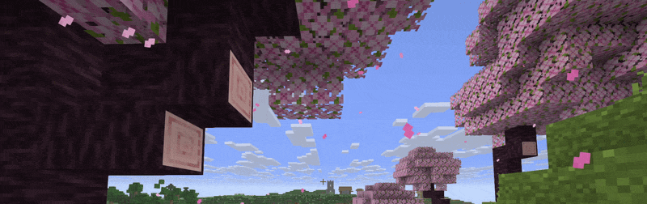

# ElytraTrails (Horizon native mod)


**Simple Port of ElytraTrails for Horizon** Based on [ElytraTrails](https://github.com/dbrighthd/elytratrails) by dbrighthd.



## What it does

While a player glides with elytra, a ribbon trail streams behind each wing and fades out over about a second. You see your own trail in third person and other players' trails too.

## Settings

Open Options > Mods > ElytraTrails:

- **Trails**: turns every trail on or off.
- **Your trail**: your own trail, in third person (F5).
- **Other players' trails**: the trails of the other players in view.
- **Color**: ice, gold, rose, violet or white.
- **Length**: short, normal or long. How long a trail stays after its point was made.
- **Width**: thin, normal or wide.

## Build

```sh
horizon-launcher native-build . --trust-native-code
```

## Credits

- ElytraTrails by [dbrighthd](https://github.com/dbrighthd/elytratrails), the original idea and visual design.

## License

MPL-2.0. See [LICENSE](LICENSE).
